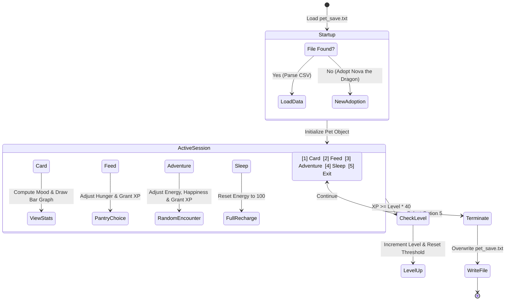

# 🐾 PetPal Simulator — Architectural Overview & Project Summary

---

## 📌 Executive Summary

**PetPal Simulator** is a lightweight, turn-based virtual pet companion and RPG adventure game implemented in **pure standard Python (<140 lines)**. The project models an interactive pet lifecycle featuring:
- Dynamic mood calculations influenced by vital stats (Hunger, Happiness, Energy).
- An experience-driven leveling system ($XP \ge Level \times 40$).
- Procedural adventure encounters with randomized risk/reward outcomes.
- Persistent state serialization using plain text file I/O (`pet_save.txt`).
- A cross-platform terminal interface with ASCII visualization and UTF-8 safe stream encoding.

---

## 🎓 Syllabus & Practical Mapping

This mini-project directly covers the fundamental concepts outlined in the **Semester 3 Introduction to Python Programming (`102040306`)** curriculum:

| Practical Module | Topic / Concept | Implementation in PetPal Simulator |
| :--- | :--- | :--- |
| **Practical 2 & 3** | Control Flow & Loops | Finite state game loop (`while True`), nested menu selection, and boundary clamping using `min()` and `max()`. |
| **Practical 5** | Data Structures (Dicts & Lists) | `MOOD_ART` dictionary lookup, food pantry menu mapping, and tuple-based adventure event sequences. |
| **Practical 6** | File Handling & String Ops | Persistent state loading and saving via `pet_save.txt` using `.split(",")`, string slicing, and formatting. |
| **Practical 7** | Exception Handling | `try...except (FileNotFoundError, ValueError, IOError)` blocks guarding file I/O and user inputs. |
| **Practical 8** | Object-Oriented Programming | `Pet` class with constructor `__init__`, state mutators (`feed`, `adventure`, `sleep`, `gain_xp`), and visual dashboard renderer (`status`). |
| **Practical 9** | Standard Modules & Math | `random.choice()` for stochastic RPG encounters and math formulas for stat adjustments. |

---

## 🏗️ System Architecture & State Machine

---

## ⚙️ Core Mechanics & Algorithmic Design

### 1. Priority Mood Determination
The mood is not a static property; it is evaluated dynamically through a priority cascade:
$$\text{Mood} = \begin{cases} 
\text{"tired"} & \text{if } \text{Energy} \le 20 \\
\text{"hungry"} & \text{if } \text{Hunger} \ge 70 \\
\text{"happy"} & \text{if } \text{Happiness} \ge 60 \\
\text{"neutral"} & \text{otherwise}
\end{cases}$$

### 2. Stat Clamping & Normalization
To prevent stat drift outside the valid range $[0, 100]$, state modifications employ defensive clamping:
$$\text{Hunger} \leftarrow \max(0, \min(100, \text{Hunger} + \Delta))$$
$$\text{Happiness} \leftarrow \max(0, \min(100, \text{Happiness} + \Delta))$$
$$\text{Energy} \leftarrow \max(0, \min(100, \text{Energy} + \Delta))$$

### 3. Procedural Exploration Engine
Adventure events use random choice over a tuple matrix `(description, happiness_delta, xp_gain)`:
- 💎 Secret Chest: $+25\text{ Happy}, +30\text{ XP}$
- 👺 Goblin Encounter: $+15\text{ Happy}, +25\text{ XP}$
- 🌊 River Dip: $+20\text{ Happy}, +20\text{ XP}$
- 🌧️ Muddy Puddle: $-10\text{ Happy}, +10\text{ XP}$

---

## 📊 Complexity Analysis

| Operation | Time Complexity | Space Complexity | Explanation |
| :--- | :--- | :--- | :--- |
| `status()` | $\mathcal{O}(1)$ | $\mathcal{O}(1)$ | Fixed string arithmetic across 3 stats |
| `feed()` | $\mathcal{O}(1)$ | $\mathcal{O}(1)$ | Constant-time dictionary lookup |
| `adventure()` | $\mathcal{O}(1)$ | $\mathcal{O}(1)$ | Uniform random indexing over 4 tuples |
| `save()` | $\mathcal{O}(1)$ | $\mathcal{O}(1)$ | Single line formatted string write (7 tokens) |
| `load_pet()` | $\mathcal{O}(1)$ | $\mathcal{O}(1)$ | Reads $\approx 30$ bytes and splits into 7 tokens |

---

## 🔒 Robustness & Fault Tolerance

1. **Cross-Platform UTF-8 Streams:** Implements automatic standard I/O reconfiguration (`sys.stdout.reconfigure(encoding="utf-8")`) to prevent `UnicodeEncodeError` on legacy Windows consoles.
2. **Missing File Graceful Fallback:** If `pet_save.txt` does not exist or contains invalid schema, the simulator intercepts `FileNotFoundError` and `ValueError` to seamlessly launch the adoption wizard.
3. **Menu Dispatcher:** Replaces nested `if-elif` ladders with a dictionary dispatcher `actions.get(choice, default_lambda)` for clean $O(1)$ routing.
