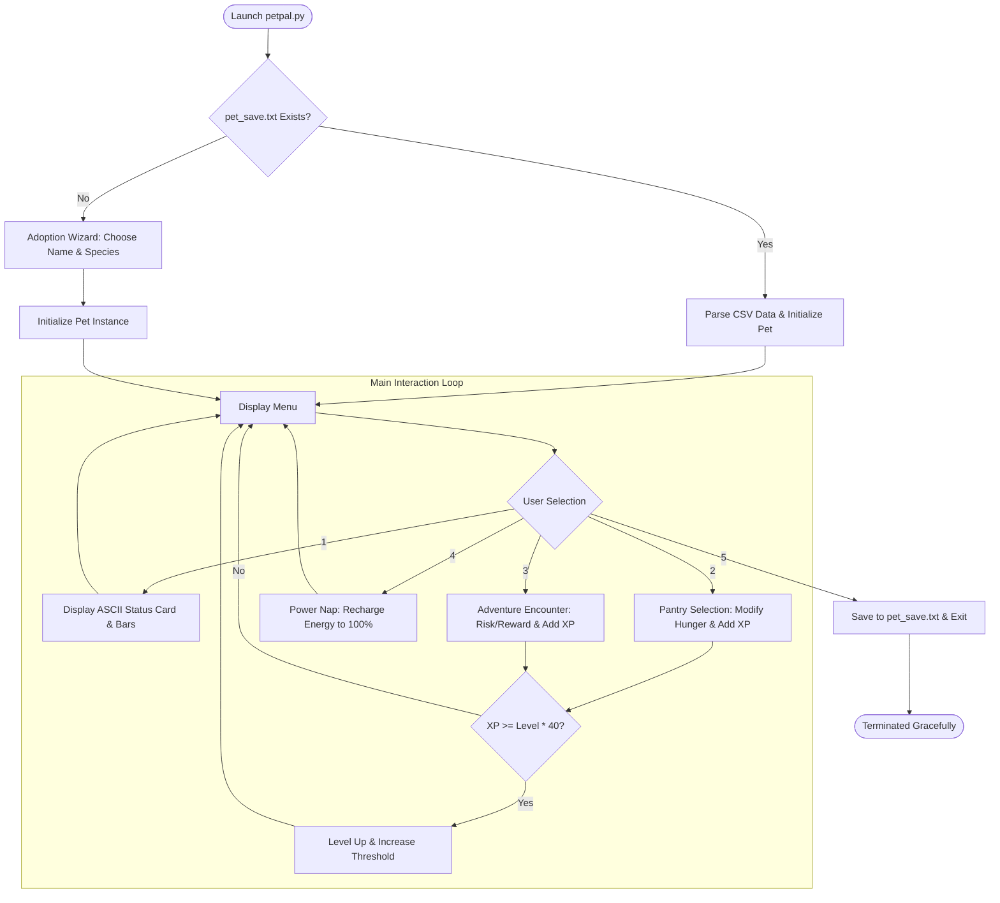

# 🐾 Python PetPal Simulator

[](LICENSE)
[](https://www.python.org/)
[-orange.svg)](#-academic-context)
[](#-how-to-run-the-project)
[](reports/Project_Report.md)
[](PROJECT_SUMMARY.md)

> An interactive, retro-inspired virtual pet and RPG adventure simulator built in **pure standard Python (<140 lines)**, demonstrating core programming concepts, object-oriented state machines, and file-based state persistence.

---

## 📌 Table of Contents
- [Executive Overview](#-executive-overview)
- [Objectives](#-objectives)
- [Key Features](#-key-features)
- [Technologies & Modules Used](#-technologies--modules-used)
- [Programming Concepts Implemented](#-programming-concepts-implemented)
- [System Architecture](#-system-architecture)
- [Project Structure](#-project-structure)
- [Installation & Setup](#-installation--setup)
- [How to Run the Project](#-how-to-run-the-project)
- [Interactive Usage Guide](#-interactive-usage-guide)
- [Sample Terminal Run](#-sample-terminal-run)
- [Academic Context](#-academic-context)
- [Documentation & Reports](#-documentation--reports)
- [License & Author](#-license--author)

---

## 📖 Executive Overview

**Python PetPal Simulator** is a console-based companion simulation and role-playing game (RPG) designed to showcase foundational Computer Science and Software Engineering principles. 

Players adopt and care for a virtual pet (such as a Dragon, Wolf, Cat, or Phoenix). Through turn-based actions—feeding, napping, and embarking on randomized exploration adventures—players nurture their pet while managing three vital meters: **Hunger**, **Happiness**, and **Energy**. The game features an experience-driven level progression system ($XP \ge \text{Level} \times 40$) and persistent disk serialization, allowing players to resume their journey at any time.

---

## 🎯 Objectives

1. **Object-Oriented Design:** Encapsulate pet physiology, behaviors, and stat mutations within a dedicated `Pet` class.
2. **Dynamic Mood Engine:** Algorithmically deduce pet mood and ASCII facial expressions from internal vital metrics.
3. **Procedural Gameplay:** Simulate random adventure encounters with risk/reward trade-offs using the standard `random` library.
4. **Data Persistence:** Implement lightweight, human-readable file storage (`pet_save.txt`) to preserve game progress across sessions.
5. **Robust Error Handling:** Prevent runtime crashes caused by missing files, corrupt records, or non-numeric inputs using defensive exception handling.
6. **Zero Dependencies:** Run seamlessly across all operating systems without installing any external `pip` packages.

---

## ✨ Key Features

- **🐾 Adoption Wizard:** Name your companion and choose from multiple species (Dragon, Wolf, Cat, Phoenix).
- **📊 Retro Status Card:** Visual ASCII bar graphs displaying real-time levels for **Hunger**, **Happiness**, and **Energy**.
- **😄 Dynamic ASCII Moods:** Facial expressions dynamically react to pet conditions:
  - `( ^ ◡ ^ ) ✨` (Happy)
  - `( • _ • )` (Neutral)
  - `( > ‸ < ) 🍽️` (Hungry)
  - `( - . - ) zZZ` (Tired)
- **🍗 Interactive Pantry:** Feed your pet treats with balanced trade-offs:
  - *Sweet Cookie:* $-15$ Hunger, $+10$ XP
  - *Juicy Steak:* $-35$ Hunger, $+15$ XP
  - *Energy Elixir:* $-10$ Hunger, $+25$ XP
- **🗺️ RPG Adventure Encounters:** Explore dangerous wilderness to uncover treasure chests, outwit goblins, or swim in mountain rivers.
- **🌟 Level-Up System:** Gain XP from feeding and adventuring to evolve and unlock higher levels.
- **💾 Automatic Save & Resume:** Seamlessly writes state to `pet_save.txt` on exit and automatically reloads upon relaunch.
- **🛡️ Cross-Platform Terminal Support:** Features automatic UTF-8 stream configuration to ensure emoji icons render cleanly on Windows PowerShell/CMD, Linux, and macOS.

---

## 🛠️ Technologies & Modules Used

| Technology | Purpose |
| :--- | :--- |
| **Python 3.8+** | Core programming language (Tested on Python 3.14) |
| **`random` Module** | Procedural event selection and stochastic reward generation (`random.choice`) |
| **`sys` Module** | Terminal stream reconfiguration for cross-platform UTF-8 encoding |
| **`reportlab` (Optional)** | Academic PDF report compilation |

> **Note:** The core simulator requires **zero external packages**—it executes entirely on the built-in Python standard library.

---

## 🧠 Programming Concepts Implemented

This project directly maps to practical experiments from the undergraduate **Introduction to Python Programming** syllabus:

| Syllabus Practical | Topic | Implementation in PetPal Simulator |
| :--- | :--- | :--- |
| **Practical 2 & 3** | Conditionals & Loops | `while True` event loop, priority mood determination cascades, and numeric stat clamping via `min()` and `max()`. |
| **Practical 5** | Data Structures (Dicts & Lists) | `MOOD_ART` ASCII mapping dictionary, consumable food menu, and adventure encounter matrices. |
| **Practical 6** | File Handling & String Methods | Reading and writing `pet_save.txt`, string tokenization (`.split(",")`), and ASCII table formatting. |
| **Practical 7** | Exception Handling | `try...except (FileNotFoundError, ValueError, IOError)` blocks guarding file I/O and user selections. |
| **Practical 8** | Object-Oriented Programming (OOP) | `Pet` class with `__init__` constructor, instance attributes, and action methods (`feed`, `adventure`, `sleep`, `status`). |
| **Practical 9** | Standard Library Modules | `random.choice()` for stochastic RPG encounter resolution. |

---

## 🏗️ System Architecture



---

## 📂 Project Structure

```text
Python-PetPal-Simulator/
│
├── petpal.py                  # Main application source code (~135 lines)
├── pet_save.txt               # Serialized game state ledger (auto-generated)
├── requirements.txt           # Environment documentation (Standard Library)
├── .gitignore                 # Standard Python gitignore rules
├── LICENSE                    # Apache License 2.0
├── README.md                  # Comprehensive project documentation
├── PROJECT_SUMMARY.md         # Executive architectural & complexity summary
│
├── assets/                    # Project visual previews and banners
│   └── banner.txt             # ASCII header banner and interface mockup
│
└── reports/                   # Academic reports and submission documentation
    ├── Project_Report.md      # Full academic project documentation (Markdown)
    └── Project_Report.pdf     # 4-page formatted academic PDF report
```

---

## 🚀 Installation & Setup

### Prerequisites
- Python 3.8 or higher installed on your system. Verify by running:
  ```bash
  python --version
  ```

### Clone the Repository
```bash
git clone https://github.com/husainkaydawala7-creator/Python-PetPal-Simulator.git
cd Python-PetPal-Simulator
```

---

## 💻 How to Run the Project

Execute the main script using standard Python:

### On Windows (CMD / PowerShell):
```powershell
python petpal.py
```

### On Linux / macOS:
```bash
python3 petpal.py
```

### In Visual Studio Code:
1. Open the repository folder in VS Code.
2. Open `petpal.py`.
3. Press **`F5`** or click the **▶️ Run Python File** button at the top-right corner.

---

## 🎮 Interactive Usage Guide

When launched, the simulator displays the main command bar:

```text
[1] Card 📋  [2] Feed 🍗  [3] Adventure 🗺️  [4] Sleep 💤  [5] Save & Exit 🚪
Command:
```

| Command | Action | Description |
| :---: | :--- | :--- |
| **`1`** | **Card 📋** | Renders the pet's ASCII status card, current mood face, vital stat bars, and XP progress. |
| **`2`** | **Feed 🍗** | Opens the pantry. Choose between Cookies, Steaks, or Elixirs to lower hunger and earn XP. |
| **`3`** | **Adventure 🗺️** | Sends your pet on an exploration quest (requires $\ge 25$ energy). Generates random rewards or obstacles. |
| **`4`** | **Sleep 💤** | Puts your pet to sleep, restoring Energy back to $100\%$ while slightly advancing hunger. |
| **`5`** | **Save & Exit 🚪** | Serializes the current pet state into `pet_save.txt` and exits cleanly. |

---

## 🖥️ Sample Terminal Run

```text
[1] Card 📋  [2] Feed 🍗  [3] Adventure 🗺️  [4] Sleep 💤  [5] Save & Exit 🚪
Command: 1

┌──────────────────────────────────┐
│ Burhan the Dragon   (Lvl 1)      │
│ Mood: ( ^ ◡ ^ ) ✨               │
├──────────────────────────────────┤
│ Hunger : [■■□□□□□□□□]  20/100    │
│ Happy  : [■■■■■■■■□□]  80/100    │
│ Energy : [■■■■■■■■■■] 100/100    │
│ XP     : 25/40                   │
└──────────────────────────────────┘

[1] Card 📋  [2] Feed 🍗  [3] Adventure 🗺️  [4] Sleep 💤  [5] Save & Exit 🚪
Command: 3

🗺️ Adventure: Burhan discovered a secret chest full of gems! 💎
🌟 LEVEL UP! Burhan evolved to Level 2! 🎉

[1] Card 📋  [2] Feed 🍗  [3] Adventure 🗺️  [4] Sleep 💤  [5] Save & Exit 🚪
Command: 5
💾 Journey saved! See you soon, Burhan!
```

---

## 🎓 Academic Context

- **Course:** Introduction to Python Programming (`102040306`)
- **Semester:** Semester 3 (Odd)
- **Institution:** G. H. Patel College of Engineering and Technology (GCET), CVM University
- **Department:** Department of Computer Engineering
- **Author:** Husain Kaydawala

---

## 📑 Documentation & Reports

- **Architecture & Complexity Breakdown:** [PROJECT_SUMMARY.md](PROJECT_SUMMARY.md)
- **Full Academic Report (Online):** [reports/Project_Report.md](reports/Project_Report.md)
- **Downloadable Academic Report (PDF):** [reports/Project_Report.pdf](reports/Project_Report.pdf)

---

## 📜 License & Author

This project is open-source and licensed under the **[Apache License 2.0](LICENSE)**.

Developed by **[Husain Kaydawala](https://github.com/husainkaydawala7-creator)**. Contributions, stars, and feedback are welcome!
