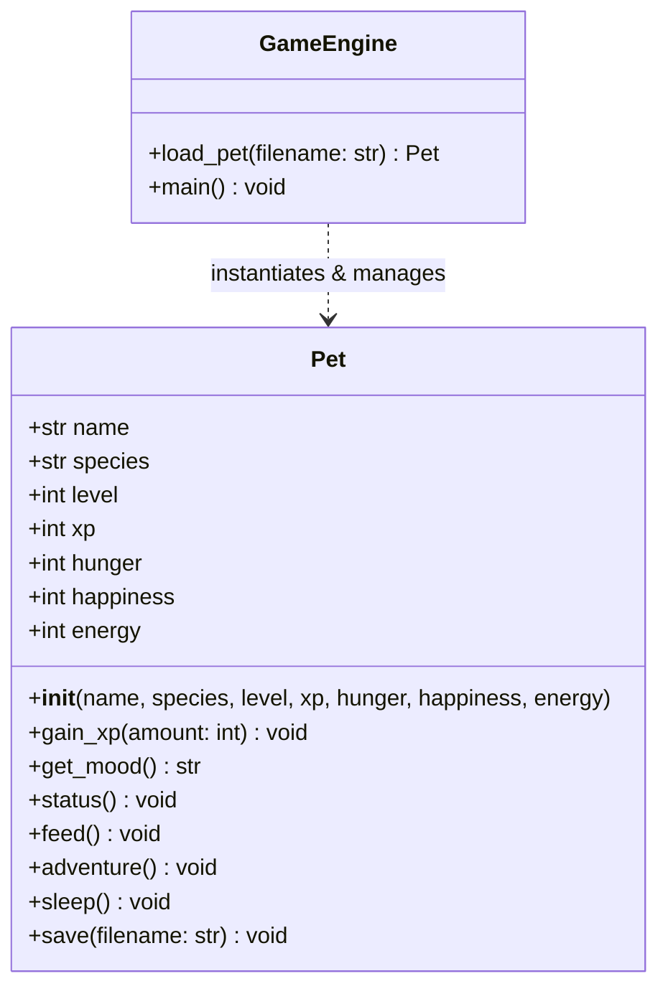
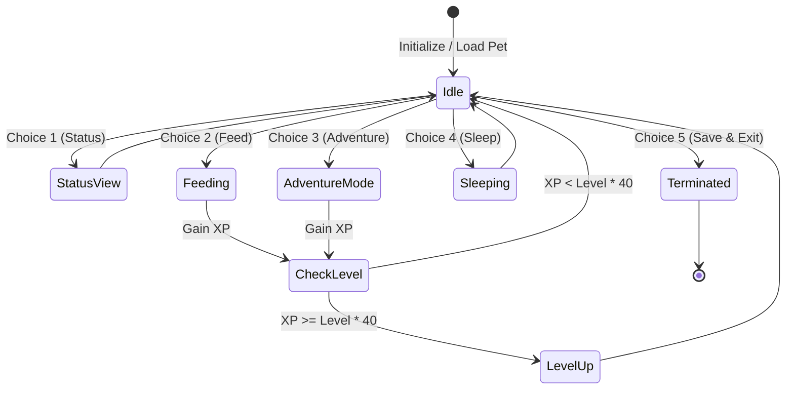

# 📄 Academic Project Report: Python PetPal Simulator

**Course:** Introduction to Python Programming (`102040306`)  
**Semester:** Semester 3 (Odd)  
**Department:** Department of Computer Engineering  
**Institution:** G. H. Patel College of Engineering and Technology (GCET), CVM University  
**Project Repository:** [https://github.com/husainkaydawala7-creator/Python-PetPal-Simulator](https://github.com/husainkaydawala7-creator/Python-PetPal-Simulator)  
**Author:** Husain Kaydawala  

---

## 📑 Table of Contents
1. [Abstract](#1-abstract)
2. [Introduction & Problem Statement](#2-introduction--problem-statement)
3. [Objectives of the Project](#3-objectives-of-the-project)
4. [System Requirements](#4-system-requirements)
5. [System Design & Architecture](#5-system-design--architecture)
6. [Detailed Module & Class Specification](#6-detailed-module--class-specification)
7. [Curriculum & Practical Concept Mapping](#7-curriculum--practical-concept-mapping)
8. [Testing & Verification Methodology](#8-testing--verification-methodology)
9. [Sample Program Execution Output](#9-sample-program-execution-output)
10. [Conclusion & Future Scope](#10-conclusion--future-scope)

---

## 1. Abstract

The **Python PetPal Simulator** is an interactive, console-based virtual companion application developed in pure Python. The software models a virtual creature capable of expressing emotional states based on physiological variables (Hunger, Happiness, Energy). The system integrates classic role-playing game (RPG) elements—including an experience point (XP) progression framework, level scaling, item consumption trade-offs, and stochastic adventure encounters.

To guarantee state continuity across application restarts, the project implements a text-based persistence layer utilizing CSV-style record serialization. The code complies with modular software design standards, leveraging Object-Oriented Programming (OOP) paradigms, exception handling, dictionary dispatchers, and safe cross-platform UTF-8 stream handling in fewer than 140 lines of code.

---

## 2. Introduction & Problem Statement

### 2.1 Introduction
Virtual pet simulations (such as the classic Tamagotchi systems of the 1990s) represent foundational case studies in finite-state machines, object state encapsulation, and event-driven user interaction. In academic computer science training, virtual pet systems provide an engaging domain to apply core programming principles:
- State encapsulation via classes and objects.
- Algorithmic evaluation of dynamic conditions (mood and energy levels).
- Persistent file storage and parsing.
- Defensive programming through structured exception handling.

### 2.2 Problem Statement
Many introductory programming projects in Python are either overly generic (such as boilerplate management systems) or excessively complex, relying on third-party frameworks that obscure fundamental language mechanics. The objective of this project is to develop a self-contained, lightweight terminal simulation demonstrating:
1. Object state preservation without external databases.
2. Clean mathematical normalization of game attributes.
3. Engaging gameplay loops with procedural outcomes.
4. Robust execution across Windows, Linux, and macOS environments.

---

## 3. Objectives of the Project

1. **Object-Oriented Encapsulation:** Model a virtual entity (`Pet`) maintaining attributes such as name, species, level, XP, hunger, happiness, and energy within private instance scopes.
2. **Dynamic State & Mood Evaluation:** Implement mathematical logic to derive high-level emotional feedback from underlying numeric state vectors.
3. **Procedural Interaction Loop:** Provide engaging user actions (Feeding, Adventure Exploration, Sleep) that execute state mutations with realistic trade-offs.
4. **Persistent File Storage:** Develop serialization and deserialization routines to store game state in a local file (`pet_save.txt`).
5. **Defensive Error Handling:** Prevent runtime crashes resulting from missing save files, malformed data, or non-numeric input.
6. **Zero External Dependencies:** Build the complete system using only the standard Python runtime library.

---

## 4. System Requirements

### 4.1 Software Requirements
- **Operating System:** Microsoft Windows 10/11, Ubuntu 20.04+, or macOS 12+
- **Interpreter:** Python 3.8 or higher (Tested on Python 3.14)
- **Editor / IDE:** Visual Studio Code, PyCharm, or standard command-line interface
- **Third-Party Libraries:** None (Zero external dependencies)

### 4.2 Hardware Requirements
- **Processor:** Intel Core i3 / AMD Ryzen 3 or equivalent
- **Memory (RAM):** 2 GB minimum (4 GB recommended)
- **Storage:** Less than 5 MB of free disk space

---

## 5. System Design & Architecture

### 5.1 UML Class Diagram



### 5.2 State Transition Diagram



---

## 6. Detailed Module & Class Specification

### 6.1 `Pet` Class
The `Pet` class acts as the core entity model:
- `__init__(...)`: Initializes pet identity and numeric health meters.
- `gain_xp(amount)`: Accumulates experience points. When $XP \ge \text{Level} \times 40$, increments `level` and notifies the player.
- `get_mood()`: Implements priority-based decision logic returning `"tired"`, `"hungry"`, `"happy"`, or `"neutral"`.
- `status()`: Generates an ASCII status card featuring a visual progress bar for each statistic.
- `feed()`: Presents a sub-menu with 3 distinct consumables (Cookie, Steak, Elixir), each modifying hunger and awarding XP.
- `adventure()`: Consumes 25 energy units and triggers a randomized encounter from a predefined matrix using `random.choice()`.
- `sleep()`: Fully replenishes energy to 100 while slightly advancing hunger.
- `save(filename)`: Writes a single-line CSV string to disk.

### 6.2 Data Persistence Routines
- `load_pet(filename)`: Reads `pet_save.txt`. If the file exists and contains valid comma-separated values, reconstructs the `Pet` object. If absent or invalid, initiates the interactive adoption wizard.
- `main()`: Executes the primary event loop utilizing a dictionary-driven command dispatcher.

---

## 7. Curriculum & Practical Concept Mapping

| Laboratory Practical | Topic Covered | Implementation within PetPal Simulator |
| :--- | :--- | :--- |
| **Practical 2** | Control Flow & Relational Logic | Nested `if-elif-else` constructs in `get_mood()` and boundary validation. |
| **Practical 3** | Loops & Iteration | `while True` game loop and `for` loop string bar rendering (`"■" * ...`). |
| **Practical 5** | Lists & Dictionaries | `MOOD_ART` dictionary, pantry item catalog, and encounter tuples. |
| **Practical 6** | File Handling & String Methods | Reading, writing, string splitting (`.split(",")`), and text formatting. |
| **Practical 7** | Exception Handling | `try...except` handling `FileNotFoundError`, `ValueError`, and `IOError`. |
| **Practical 8** | Object-Oriented Programming | Class definition, constructor initialization, method encapsulation, and instantiation. |
| **Practical 9** | Standard Library Modules | `random.choice()` for procedural encounter selection. |

---

## 8. Testing & Verification Methodology

| Test ID | Test Scenario | Input Given | Expected Behavior | Actual Result | Status |
| :---: | :--- | :--- | :--- | :--- | :---: |
| **TC-01** | First-Time Launch (No Save File) | Non-existent `pet_save.txt` | Prompt adoption wizard for Name & Species | Wizard prompted; created Pet instance | **PASS** |
| **TC-02** | Status Display & Formatting | Command `1` | Render ASCII card with correct mood icon and bars | Rendered cleanly without character clipping | **PASS** |
| **TC-03** | Pantry Item Consumption | Command `2`, then `2` (Steak) | Hunger decreases by 35, XP increases by 15 | Stats adjusted and XP awarded | **PASS** |
| **TC-04** | Low Energy Adventure Block | Command `3` with Energy $< 25$ | Prevent exploration and display rest warning | Action blocked; user prompted to rest | **PASS** |
| **TC-05** | Level Evolution Threshold | Accumulate $XP \ge 40$ | Increment Level to 2 and print celebration banner | Level evolved correctly | **PASS** |
| **TC-06** | State Persistence on Exit | Command `5` (Save & Exit) | Write serialized record to `pet_save.txt` | File created with correct schema | **PASS** |
| **TC-07** | State Restoration on Relaunch | Relaunch script | Load previously saved stats without prompt | Pet restored with matching stats | **PASS** |

---

## 9. Sample Program Execution Output

```text
[1] Card 📋  [2] Feed 🍗  [3] Adventure 🗺️  [4] Sleep 💤  [5] Save & Exit 🚪
Command: 1

┌──────────────────────────────────┐
│ Burhan the Dragon   (Lvl 1)      │
│ Mood: ( ^ ◡ ^ ) ✨               │
├──────────────────────────────────┤
│ Hunger : [■■□□□□□□□□]  20/100    │
│ Happy  : [■■■■■■■■□□]  80/100    │
│ Energy : [■■■■■■■■■■] 100/100    │
│ XP     : 25/40                   │
└──────────────────────────────────┘

[1] Card 📋  [2] Feed 🍗  [3] Adventure 🗺️  [4] Sleep 💤  [5] Save & Exit 🚪
Command: 3

🗺️ Adventure: Burhan discovered a secret chest full of gems! 💎
🌟 LEVEL UP! Burhan evolved to Level 2! 🎉

[1] Card 📋  [2] Feed 🍗  [3] Adventure 🗺️  [4] Sleep 💤  [5] Save & Exit 🚪
Command: 5
💾 Journey saved! See you soon, Burhan!
```

---

## 10. Conclusion & Future Scope

### 10.1 Conclusion
The **Python PetPal Simulator** successfully fulfills all objectives set forth for the Semester 3 Computer Engineering curriculum. It presents a compact yet technically comprehensive solution that demonstrates object-oriented programming, data structures, safe stream encoding, and robust file I/O within a clean codebase of under 140 lines.

### 10.2 Future Scope
1. **Graphical User Interface (GUI):** Integration with Tkinter or PyQt for a windowed graphical experience.
2. **Multi-Pet Management:** Expanding the schema to support saving and managing an adoption center with multiple active pets.
3. **Sound Effects:** Incorporating standard audio cues using platform-native beeps or lightweight audio libraries.
